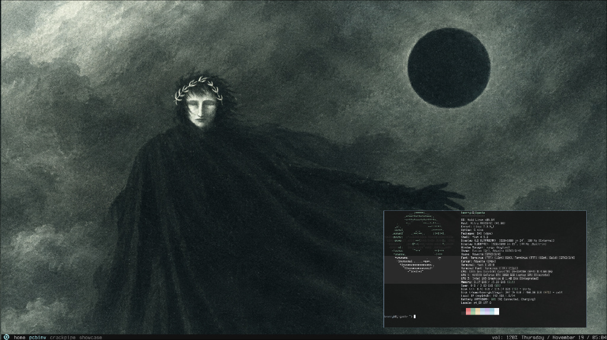

# dotfiles

Minimalist Wayland environment on **Void Linux**.

## stack

* **os:** Void Linux (`x86_64` / `runit`)
* **compositor:** [mango](https://github.com/DreamMaoMao/mangowc) (Wayland)
* **bar:** waybar
* **terminal:** foot
* **launcher:** rofi
* **shell:** fish
* **font:** Terminus (TTF)

## structure

* `foot/` — terminal configuration & colorscheme
* `mango/` — compositor keybinds, rules & layout
* `rofi/` — application launcher theme
* `waybar/` — bottom status bar layout & styling

## installation

1. **Install dependencies (Void Linux):** `sudo xbps-install -S waybar foot rofi fish-shell terminus-font` *(ensure `mango` is compiled and installed on your system)*
2. **Clone the repository:** `git clone https://github.com/KueBrto/DotFiles.git && cd DotFiles`
3. **Copy configurations:** `cp -r foot mango rofi waybar ~/.config/`
4. **Reload:** Restart your Wayland session or reload `waybar` and `mango` to apply the changes.
